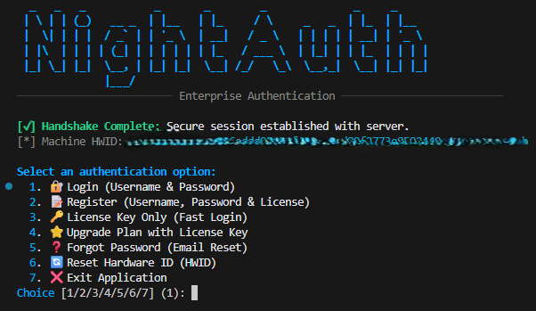
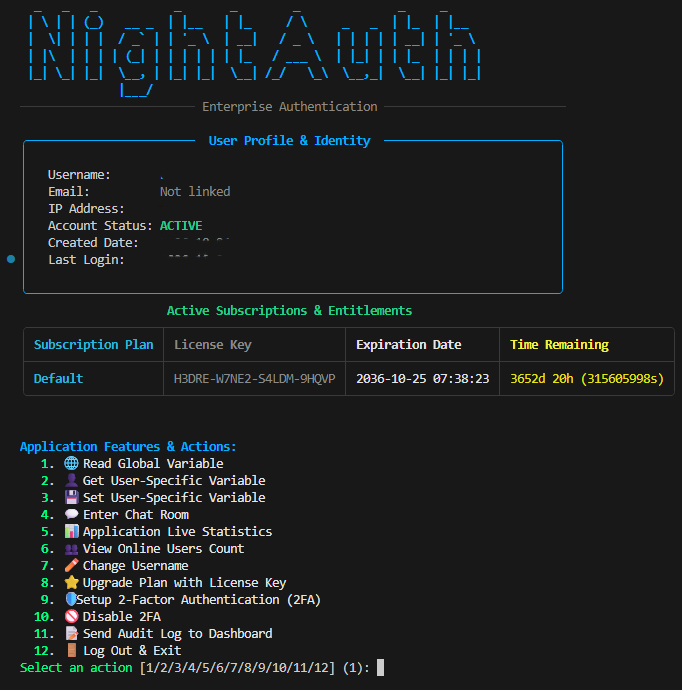

# NightAuth Node.js SDK — 在 GitHub 上为我们点亮 Star ⭐

官方 **NightAuth** Node.js SDK 与参考交互式终端控制台 CLI 套件。几分钟内为您的 Node.js、Electron 以及 JavaScript 应用程序集成云端授权许可、硬件 HWID 机器码锁定、实时事件监听、加密云端变量以及内存中安全执行，全方位抵御破解与逆向工程。

官方网站: [https://nightauth.org](https://nightauth.org)

---

**Languages / Idiomas / Langues / Sprachen:**  
[English](../README.md) • [Español](es.md) • [Français](fr.md) • [Deutsch](de.md) • [Italiano](it.md) • [Português](pt.md) • [Русский](ru.md) • [Türkçe](tr.md) • [Polski](pl.md) • [中文](zh.md)

---

> [!NOTE]
> ### 📺 视频教程与系统部署指南
> 关于如何在 NightAuth 控制面板中配置应用程序、订阅套餐、云端变量、Webhook 以及授权许可证的官方视频教程和详细图文指南**即将发布**在官方门户与 YouTube 频道。

---

## 📸 运行效果截图

### 终端控制台客户端（交互式命令行 CLI）

| 终端登录界面 | 交互式控制台面板 |
| :---: | :---: |
|  |  |

---

## 🛡️ 官方推荐安全实践

* **代码混淆与压缩：** JavaScript 代码极易被反编译和逆向分析。在生产发布时，请务必使用 **javascript-obfuscator** 进行深度混淆，启用控制流平坦化、死代码注入以及字符串高强度加密。
* **原生单文件二进制打包：** 使用 **pkg**、**ncc** 或 Node.js 原生的单文件可执行文件（**SEA**）将 Node.js 应用程序打包为独立的原生二进制可执行文件。
* **企业级二进制加壳保护：** 使用商业级代码加壳虚拟化工具（如 **VMProtect**、**Themida** 或 **Enigma Protector**）对生成的原生可执行文件进行保护。
* **内存敏感缓冲区清理与反调试：** 在使用完敏感密码、解密令牌和密钥后，请立即通过清零覆写内存缓冲区（`fileBuffer.fill(0)`）。NightAuth 内置针对分析工具和调试器（`HTTPDebugger`、`CheatEngine`、`x64dbg`、`Wireshark` 等）的防护机制。请在生产环境中始终保持安全检查开启。
* **内存安全动态执行：** 通过 `NightAuthApp.downloadFile()` 下载受保护的核心业务模块或脚本时，**切勿将解密后的字节写入本地物理磁盘**。直接在内存中执行缓冲区（例如 child_process 管道、原生扩展模块或反射执行），并在执行后立即彻底销毁内存缓冲区。

---

## 📦 环境依赖与安装

需要 **Node.js >= 18.0.0**。

```bash
npm install
```

---

## ⚙️ 凭证配置与初始化

在 NightAuth 控制台的 **Manage Apps** 选项卡中定义您的应用程序凭据：

```javascript
const { Api } = require("./sdk/nightauth.js");

const NightAuthApp = new Api(
  /* name    */ "",
  /* apikey  */ "",
  /* version */ "1.0",
  /* token   */ null
);
```

### 初始化加密握手 (`init`)

在执行任何其他 SDK 函数之前，必须调用 `init()`。这将建立基于临时 Diffie-Hellman (X25519) 的密钥交换并创建安全加密会话：

```javascript
await NightAuthApp.init();

if (!NightAuthApp.response.success) {
  console.error(`Initialization failed: ${NightAuthApp.response.message}`);
  process.exit(1);
}
```

---

## 🚀 SDK 核心功能开发指南

### 1. 验证会话与黑名单状态

```javascript
// Validate active session status with the server
await NightAuthApp.check();
if (!NightAuthApp.response.success) {
  console.log(`Session invalid: ${NightAuthApp.response.message}`);
}

// Check if client HWID or IP address is blacklisted
const black = await NightAuthApp.checkBlacklist();
if (black.blacklisted) {
  console.error("Access Denied: Machine or IP is blacklisted.");
  process.exit(1);
}
```

### 2. 用户名密码登录（支持 2FA）

```javascript
const loggedIn = await NightAuthApp.login(username, password, totpCode);

if (loggedIn) {
  console.log(`Welcome back, ${NightAuthApp.user.username}!`);
} else {
  console.error(`Login failed: ${NightAuthApp.response.message}`);
}
```

### 3. 使用许可证密钥注册

```javascript
const registered = await NightAuthApp.register(username, password, licenseKey, email);

if (registered) {
  console.log(`Registration successful: ${NightAuthApp.user.username}!`);
} else {
  console.error(`Registration failed: ${NightAuthApp.response.message}`);
}
```

### 4. 仅使用许可证密钥认证（支持 2FA）

```javascript
// Authenticate using license key alone or with 2FA TOTP code
const valid = await NightAuthApp.license(licenseKey, totpCode);

if (valid) {
  console.log(`License valid! Logged in as: ${NightAuthApp.user.username}`);
} else {
  console.error(`License authentication failed: ${NightAuthApp.response.message}`);
}
```

### 5. 升级账户 / 兑换许可证密钥

```javascript
const upgraded = await NightAuthApp.upgrade(username, licenseKey);

if (upgraded) {
  console.log(`Account upgraded: ${NightAuthApp.response.message}`);
  await NightAuthApp.check(); // Refresh session subscriptions
} else {
  console.error(`Upgrade failed: ${NightAuthApp.response.message}`);
}
```

### 6. 重置硬件 ID（HWID 绑定）

```javascript
const reset = await NightAuthApp.resetHwid(username, password, totpCode);

if (reset) {
  console.log("Hardware fingerprint reset successfully.");
} else {
  console.error(`HWID reset failed: ${NightAuthApp.response.message}`);
}
```

### 7. 忘记密码 / 账户找回

```javascript
// Step 1: Request recovery email link
await NightAuthApp.forgotPassword("user@example.com");

// Step 2: Complete reset using token received via email
const updated = await NightAuthApp.resetPassword(resetToken, newPassword);
if (updated) {
  console.log("Password updated successfully.");
}
```

### 8. 用户个人资料 (`NightAuthApp.user`)

```javascript
const u = NightAuthApp.user;
console.log(`Username: ${u.username}`);
console.log(`Email: ${u.email}`);
console.log(`HWID: ${u.hwid}`);
console.log(`Client IP: ${u.ip}`);
console.log(`Account Status: ${u.status}`);
console.log(`Created At: ${u.createdAt}`);
console.log(`Last Login: ${u.lastLoginAt}`);

for (const sub of u.subscriptions) {
  console.log(`Tier: ${sub.subscription} | Key: ${sub.key} | Expires: ${sub.expiry} | Seconds Left: ${sub.timeLeft}`);
}
```

### 9. 全局云变量

```javascript
const motd = await NightAuthApp.getGlobalVar("server_motd");
console.log(`Announcement: ${motd}`);
```

### 10. 用户专属变量

```javascript
// Retrieve a per-user encrypted variable
const theme = await NightAuthApp.getUserVar("custom_theme");

// Set or update a per-user variable
await NightAuthApp.setUserVar("custom_theme", "dark_obsidian");

// Fetch all per-user variables
const varsLoaded = await NightAuthApp.getUserVariables();
if (varsLoaded) {
  console.log("User variables loaded successfully.");
}
```

### 11. 应用程序审计日志

```javascript
await NightAuthApp.log("User initialized workflow #42");
```

### 12. 封禁用户并加入设备黑名单

```javascript
await NightAuthApp.ban("Security tampering detected");
```

### 13. 服务端 Webhook 与文件上传

```javascript
// 1. Trigger JSON payload webhook
const payload = { event: "user_action", score: 42 };
const responseText = await NightAuthApp.triggerWebhook("webhook-id", payload);
if (responseText !== null) {
  console.log(`Webhook response: ${responseText}`);
}

// 2. Upload file securely via server-side webhook proxy
const reportBuffer = Buffer.from("Audit dump content...", "utf8");
const uploadResult = await NightAuthApp.triggerWebhook("webhook-id", payload, null, null, reportBuffer, "audit.log");
```

### 14. 内存中安全文件下载

```javascript
const fileBuffer = await NightAuthApp.downloadFile("asset_file_id");

if (fileBuffer) {
  console.log(`File downloaded securely into memory (${fileBuffer.length} bytes).`);
  // Process buffer directly in memory without saving to physical disk
  // Wipe buffer from memory immediately after execution:
  fileBuffer.fill(0);
} else {
  console.error(`Download failed: ${NightAuthApp.response.message}`);
}
```

### 15. 实时加密聊天频道

```javascript
// Fetch recent message history
const messages = await NightAuthApp.getChatMessages("general", null, true);
for (const msg of messages) {
  console.log(`[${msg.timestamp}] ${msg.author}: ${msg.message}`);
}

// Send a message to a channel
await NightAuthApp.sendChatMessage("Hello from Node.js SDK!", "general");
```

### 16. 实时事件流（Server-Sent Events）

```javascript
// Triggered if the admin terminates or invalidates the session
NightAuthApp.onSessionInvalidated = (reason) => {
  console.error(`[SECURITY ALERT] Session Invalidated: ${reason}`);
  process.exit(1);
};

// Triggered if the application is banned
NightAuthApp.onAppBanned = (reason) => {
  console.error(`[CRITICAL BAN] Application Banned: ${reason}`);
  process.exit(1);
};

// Triggered if application status changes (e.g. maintenance mode)
NightAuthApp.onAppStatusChanged = (status) => {
  console.warn(`[STATUS CHANGE] App is now: ${status}`);
};

// Triggered when an update is published
NightAuthApp.onVersionUpdated = (newVersion) => {
  console.log(`[UPDATE] New version available: v${newVersion}`);
};

// Triggered on incoming chat messages
NightAuthApp.onChatMessageReceived = (msg, room) => {
  console.log(`[CHAT #${room}] ${msg.author}: ${msg.message}`);
};

// Start listening for real-time events
NightAuthApp.startRealtimeEventListener();
```

### 17. 双因素身份验证 (2FA / TOTP)

```javascript
// Step 1: Initialize TOTP setup
const setupData = await NightAuthApp.setup2FA();
if (setupData) {
  console.log(`Secret Key: ${setupData.secret}`);
  console.log(`Authenticator URI: ${setupData.uri}`);

  // Step 2: Confirm 2FA with 6-digit code from authenticator app
  const confirmData = await NightAuthApp.confirm2FA("123456");
  if (confirmData) {
    console.log("2FA enabled successfully! Backup Codes:");
    for (const code of confirmData.backupCodes) {
      console.log(` - ${code}`);
    }
  }
}

// Step 3: Disable 2FA if needed
const disabled = await NightAuthApp.disable2FA(password, "123456");
```

### 18. 会话生命周期与注销

```javascript
// Keep session active with periodic ping
await NightAuthApp.heartbeat();

// Revoke session on cloud and close client
await NightAuthApp.logout();
NightAuthApp.close();
```

### 19. 修改账户用户名

```javascript
const changed = await NightAuthApp.changeUsername("new_alias", "CurrentPassword123!");

if (changed) {
  console.log(`Username changed successfully to: ${NightAuthApp.user.username}`);
} else {
  console.error(`Change username failed: ${NightAuthApp.response.message}`);
}
```

### 20. 应用统计分析与在线用户列表

```javascript
// Retrieve application usage statistics
const stats = await NightAuthApp.getStats();
if (stats) {
  console.log(`Users: ${stats.activeUsers} active / ${stats.totalUsers} total`);
  console.log(`Licenses: ${stats.usedLicenses} used / ${stats.totalLicenses} total`);
}

// Fetch list of currently online usernames
const onlineUsers = await NightAuthApp.getOnlineUsers();
console.log(`Online users (${onlineUsers.length}): ${onlineUsers.join(", ")}`);
```

### 21. 文件完整性校验与哈希比对

```javascript
const fileSha256 = "e3b0c44298fc1c149afbf4c8996fb92427ae41e4649b934ca495991b7852b855";
const valid = await NightAuthApp.verifyFileHash(fileSha256);

if (valid) {
  console.log("Binary matches registered server checksum.");
} else {
  console.error("Integrity verification failed!");
}
```

### 22. 硬件指纹提取与安全检测 (`SecurityProtections`)

```javascript
const { SecurityProtections } = require("./sdk/nightauth.js");

// Retrieve stable hardware fingerprint identifier
const hwid = SecurityProtections.getHardwareId();
console.log(`Device HWID: ${hwid}`);

// Run anti-debugging and proxy security checks
SecurityProtections.runSecurityChecks();
```

### 23. 独立配置、超时设置与自定义服务端公钥

```javascript
// Initialize with custom API endpoint
const customAuth = new Api(
  "Custom App",
  "na_custom_key",
  "1.0",
  null,
  "https://nightauth.org/api/v1"
);

// Configure HTTP request timeout (milliseconds)
customAuth.requestTimeoutMs = 15000;

// Pin server signing public key (hex)
customAuth.signingPin = "cdb2285db481666ce40003aadb874c8751dbeb9a0672a37f740dfe881ecdc742";
```

### 24. 签名自更新与防回滚保护

```javascript
const { SignedUpdateInstaller } = require("./sdk/nightauth.js");

// Download and verify Ed25519 digitally signed update manifest with monotonic sequence protection
const downloadedPath = await SignedUpdateInstaller.download(
  "https://releases.example.com/manifest.json",
  "cdb2285db481666ce40003aadb874c8751dbeb9a0672a37f740dfe881ecdc742",
  "SDK Example App",
  "updates/app-v2.0.js"
);
console.log(`Verified update downloaded to: ${downloadedPath}`);
```

---

## 🖥️ 运行交互式终端控制台客户端

```bash
# Configure application environment variables (optional)
export NIGHTAUTH_APP_NAME="YourApp"
export NIGHTAUTH_API_KEY="na_live_xxx"

# Run interactive console
npm run console
```

---

## 📄 许可证

本项目采用 **Elastic License 2.0** 许可证。

* 您不得将本软件作为托管或托管服务提供给第三方。
* 您不得移动、更改、禁用或规避许可证密钥功能。
* 您不得更改、删除或掩盖任何许可或版权声明。

完整法律文本请参阅 [LICENSE](../LICENSE) 文件。

---

**Languages / Idiomas / Langues / Sprachen:**  
[English](../README.md) • [Español](es.md) • [Français](fr.md) • [Deutsch](de.md) • [Italiano](it.md) • [Português](pt.md) • [Русский](ru.md) • [Türkçe](tr.md) • [Polski](pl.md) • [中文](zh.md)
